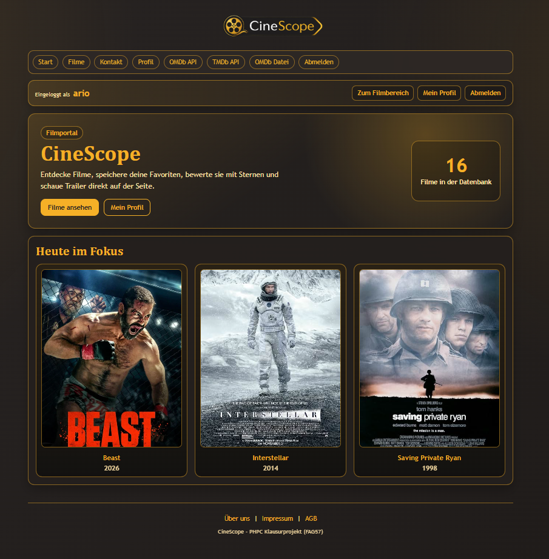
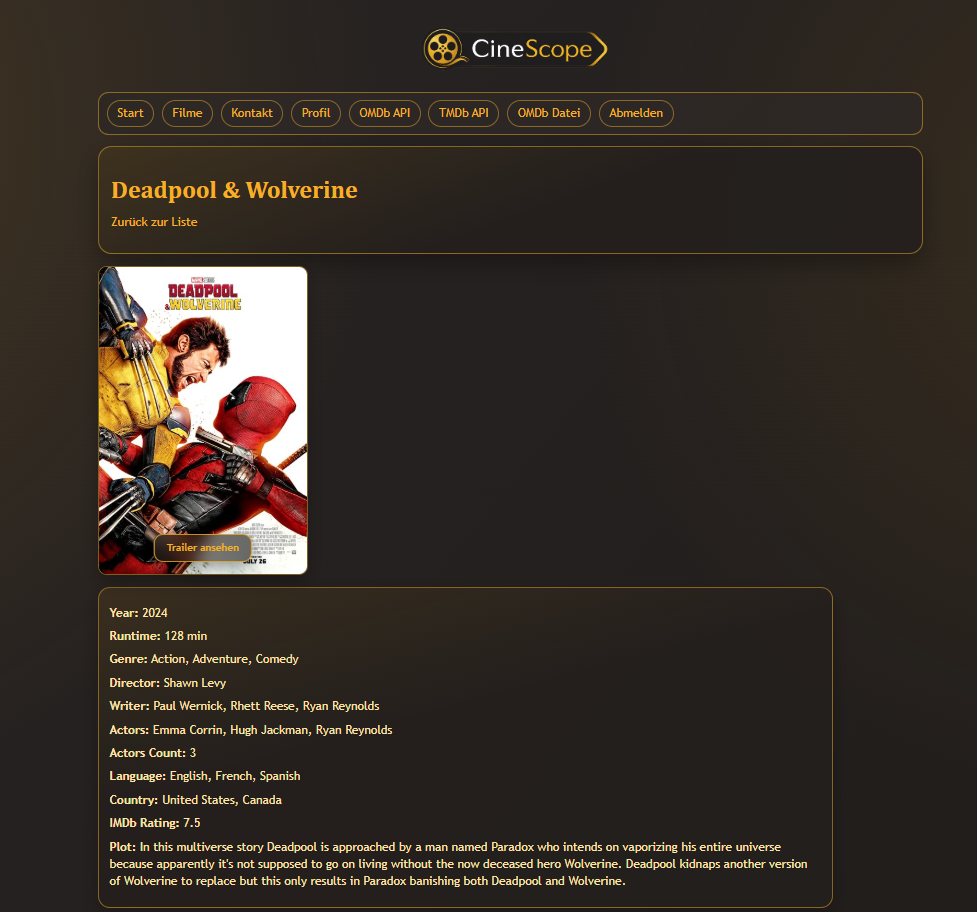
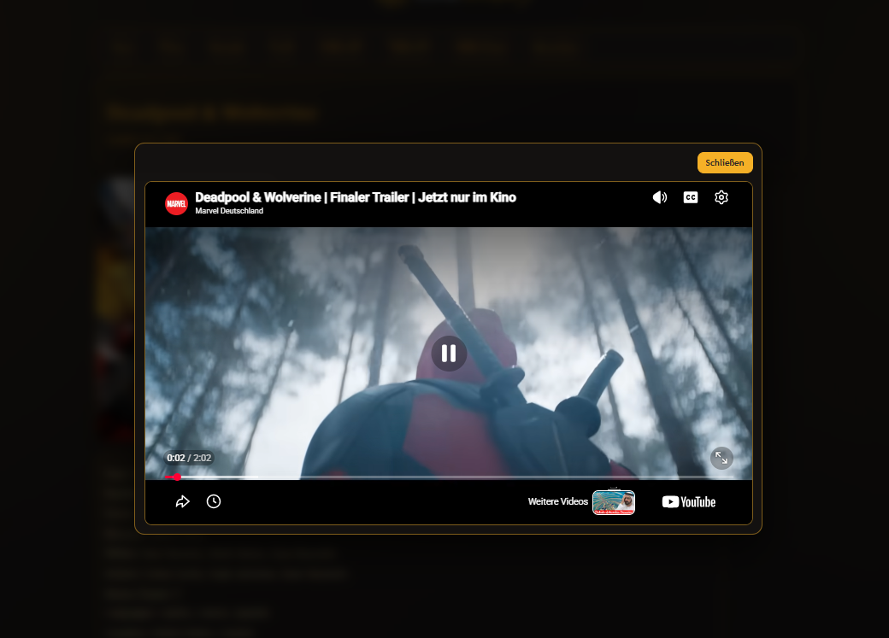

# CineScope

Ein Filmportal mit PHP und MySQL, eigenständig entwickelt während meiner Umschulung zum Fachinformatiker für Anwendungsentwicklung bei CBW. CineScope verbindet eine lokale Filmdatenbank mit der OMDb API und zeigt die Verarbeitung von Benutzereingaben, relationalen Daten und JSON/XML in einer Webanwendung.

**Live-Demo:** https://ario-mi.github.io/cinescope-php/ (statisch, mit Beispieldaten; Anmeldung und Speichern nur in der Vollversion)

## Vorschau







Die Filmplakate und Trailer stammen von externen Quellen und gehören den jeweiligen Rechteinhabern (siehe [ASSETS.md](docs/ASSETS.md)).

## Funktionen

- Filmsuche nach Titel, Jahr, Schauspieler, Regie und Genre
- AJAX-Suchvorschläge mit direkten Links zur Filmansicht und Seitennavigation
- Registrierung und Anmeldung mit Passwort-Hashes
- Persönliche Merkliste und Kommentare
- Bewertungen mit 1 bis 5 Sternen; Durchschnitt in Liste und Detailansicht, Sortierung nach Bewertung
- Trailer im Overlay: Der YouTube-Trailer wird einmalig über die TMDb API gesucht und in der Datenbank gespeichert
- TMDb-Import für neue Filme, die OMDb noch nicht kennt
- Profilseite mit eigener Merkliste, eigenen Bewertungen und Kommentaren sowie Passwortänderung
- Lesen von Filmdaten über die OMDb API in JSON und XML sowie Datenbankimport
- Lesen lokaler JSON/XML-Beispieldateien
- Administration mit Statistiken, Löschfunktionen und JSON/CSV/XML-Export

## Technik und Aufbau

PHP 8.2, PDO, MySQL/MariaDB, HTML, CSS und JavaScript ohne Framework. Das Datenmodell verwendet Fremdschlüssel und n:m-Beziehungen für Genres, Schauspieler, Regie und Drehbuch. Die Anwendung trennt gemeinsame Konfiguration, Seitentemplates und Navigation in eigene Dateien; sie verwendet keine vollständige MVC-Architektur.

```text
admin/          Administration und Styles
bilder/         Logo und Ersatzgrafik
css/, js/       Styles und AJAX-Suche
data/files/     JSON/XML-Beispiele
data/sql/       Schema und Beispieldaten
docs/           Architektur und Testbeschreibung
include/        Konfiguration, PDO und Formularschutz
scripts/        Admin-Einrichtung, Release-Erstellung und Demo-Build
test/           Automatisierte HTTP- und Datenbanktests
views/          Templates und gemeinsame Seitenelemente
```

## Lokal installieren

1. XAMPP mit PHP 8.2, Apache und MySQL/MariaDB starten. Benötigt werden PDO MySQL, mbstring, SimpleXML und DOM; für OMDb außerdem HTTPS-Unterstützung und `allow_url_fopen`.
2. Das Projekt als `cinescope-php` unter `htdocs` ablegen.
3. Zuerst `data/sql/schema.sql`, danach `data/sql/seed.sql` importieren. Standard-Datenbankname: `cinescope`. **Das Schema löscht vorhandene Projekttabellen dieser Datenbank; nur für eine neue lokale Übungsinstallation verwenden.**
4. `include/config.example.php` nach `include/config.local.php` kopieren und die lokalen Datenbankdaten eintragen. Die lokale Datei gehört nicht ins Repository. Alternativ lassen sich die Schlüssel als Umgebungsvariablen setzen.
5. Für die Online-Funktionen einen eigenen OMDb-Schlüssel als `OMDB_API_KEY` konfigurieren. Für Trailer und den TMDb-Import zusätzlich einen TMDb-Schlüssel als `TMDB_API_KEY`. Ohne Schlüssel funktionieren die lokalen Filmfunktionen weiterhin; Trailer und TMDb-Import sind dann ausgeschaltet.
6. `http://localhost/cinescope-php/start.php` öffnen und ein Benutzerkonto registrieren.

Die bestehende Entwicklungsinstallation kann über `DB_NAME` weiterhin ihre bisherige Datenbank verwenden; ein Umbenennen vorhandener Datenbanken ist nicht nötig. Eine bestehende Datenbank ohne Bewertungen und Trailer wird mit `data/sql/migrations/001_bewertungen_trailer_tmdb.sql` ergänzt, ohne Daten zu löschen.

## Admin-Zugang

Im Projektordner ausführen:

```powershell
C:\xampp\php\php.exe scripts\configure-admin.php
```

Das Skript fragt Benutzername und ein Passwort mit mindestens zwölf Zeichen ab. Die Eingabe im Terminal ist sichtbar. Nur der Passwort-Hash wird in der lokalen Konfiguration gespeichert. Ohne eingerichteten Hash bleibt die Administration gesperrt; es gibt kein voreingestelltes Admin-Passwort.

## Tests

```powershell
python test/security_checks.py
python test/functional_checks.py
```

Python 3.11 oder neuer wird benötigt. Standardpfade: PHP unter `C:\xampp\php\php.exe`, MariaDB-Binärdateien unter `C:\xampp\mysql\bin`. Abweichende Pfade lassen sich über `PHP_BINARY` bzw. `MYSQL_BIN` setzen.

Die Funktionstests starten eine eigene temporäre MariaDB-Instanz auf einem freien lokalen Port. Testdaten, Sessions und Exporte werden getrennt angelegt und anschließend entfernt. Die normale XAMPP-Datenbankinstanz wird dabei nicht verwendet.

Optionale Live-Prüfung mit eigenem lokal konfigurierten OMDb-Schlüssel:

```powershell
$env:RUN_LIVE_OMDB = '1'
python test/functional_checks.py
Remove-Item Env:RUN_LIVE_OMDB
```

Live-Tests benötigen Internetzugang und verbrauchen API-Anfragen. Prüfstand und Grenzen: [Tests](docs/TESTING.md). Aufbau und Datenfluss: [Architektur](docs/ARCHITECTURE.md).

## Statische Demo auf GitHub Pages

GitHub Pages kann kein PHP ausführen. Deshalb startet GitHub Actions (`.github/workflows/pages.yml`) die echte Anwendung mit einer MariaDB-Testdatenbank und dem PHP-Testserver, führt zuerst die Sicherheitstests aus und erzeugt dann mit `scripts/build_demo.py` eine statische Kopie der öffentlichen Seiten. Das Skript legt dabei Demo-Konten mit Beispielbewertungen an, ruft alle Seiten als Besucher ab und schreibt die Links auf die erzeugten HTML-Dateien um. Formulare sind in der Demo deaktiviert; Suchvorschläge und Sortierung funktionieren.

Optional können im Repository unter **Settings → Secrets and variables → Actions** die Secrets `OMDB_API_KEY` (weitere Demo-Filme aus `scripts/demo_films.txt`) und `TMDB_API_KEY` (Trailer) hinterlegt werden. Ohne Secrets zeigt die Demo die vier Filme aus `seed.sql`.

## Sicherheit und Grenzen

Die Anwendung verwendet vorbereitete SQL-Abfragen, Passwort-Hashes, CSRF-Tokens und Session-Erneuerung beim Login. API-Schlüssel stehen nur in `config.local.php` oder in Umgebungsvariablen. Trailer-Keys von TMDb werden vor dem Speichern und Einbetten geprüft (nur Buchstaben, Ziffern, `-` und `_`), eingebettet wird über `youtube-nocookie.com`. Verzeichnisse mit Konfiguration, Daten, Skripten und Tests werden unter Apache durch `.htaccess` geschützt; dafür muss `AllowOverride` aktiviert sein. Der PHP-Testserver wertet diese Dateien nicht aus.

Dies ist eine lokale Lern- und Bewerbungsarbeitsprobe, kein fertig gehärteter öffentlicher Dienst. Die externe Suche nach Schauspieler, Regie und Genre filtert Titel-Suchergebnisse; sie durchsucht nicht den vollständigen OMDb-Bestand nach diesen Kategorien. Bildquellen stehen in [ASSETS.md](docs/ASSETS.md).

## Bereinigte Ausgabe erstellen

```powershell
python scripts/prepare-release.py
```

Die Ausgabe liegt als Ordner `dist/cinescope-php/` und als Archiv `dist/cinescope-php.zip` vor. Lokale Konfiguration, Backups, Logs, Exporte und interne Arbeitsdateien werden ausgeschlossen. Für GitHub wird ausschließlich der Inhalt des bereinigten Ordners verwendet.
